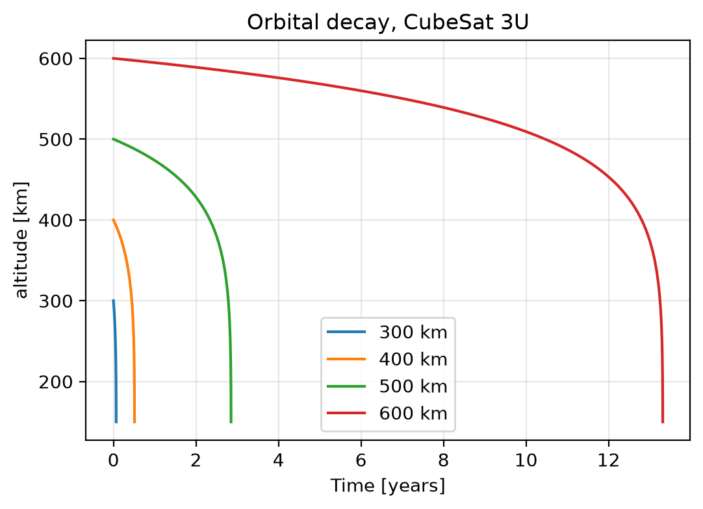

# Orbital Decay of a 3U CubeSat
Orbital decay simulation of a 3U Cubesat in Python 

Python simulation of how atmospheric drag lowers a CubeSat's orbit, in order to 
estimate orbital lifetime between 300 and 600 km.

## Objective
Without propulsion, estimate how long a 3U CubeSat  stays in orbit at different
release altitudes and identify the consequent design constraint.

## Theory
For a circular orbit of radius a = R + h:
da/dt = -rho * B * sqrt(mu * a), with B = Cd * A / m.
Derived from E = -mu/(2a) and the drag power loss dE/dt = -0.5 * rho * B * v^3.

## Assumptions
Circular orbit
Density depends only on altitude
Constant drag area
No other perturbations
Re-entry value at 150 km.

## Satellite parameters
Assumed values:
Mass 4 kg 
Cd = 2.2
A = 0.03 m²  

## Atmospheric density data
## Atmospheric density data

Mass density values were obtained from the NRLMSIS 2.0 empirical atmosphere
model, accessed through the open-source `pymsis` Python package
(https://github.com/SWxTREC/pymsis). 
They are averages over 24 hours on 15 April 2014 (active Sun) and over 30 locations (6 longitudes x 5 latitudes), for altitudes from 150 to 800 km, and are listed in `data/density_table.csv`.
Values between table points are interpolated on log(density).

Model reference:
Emmert, J. T., et al. (2021). NRLMSIS 2.0: A whole-atmosphere empirical model
of temperature and neutral species densities. Earth and Space Science, 8(3),
e2020EA001321. https://doi.org/10.1029/2020EA001321

Limitation: a single solar-activity case is used, so the lifetimes are short
estimates.

## Validation
For the ISS (estimated mass 420,000 kg and area 1,600 m²) at 400 km, the model
gives a 4.59 km altitude loss over 30 days, matching the observed
decay of a few km per month, varyng with solar activity.

## Results
Altitude (km)- Lifetime, A = 0.03 m² (years)
For CubeSat:
300 km: 0.07 years
400 km: 0.51 years
500 km: 2.85 years
600 km: 13.31 years
">30" = no re-entry within the 30 simulated years.

For ISS:
300 km: 0.2 years 
400 km: 1.53 years 
500 km: 8.55 years 
600 km: 30.0 years (more than 30 years)
decay in 30 days = 4.59 km

## Sensitivity to drag area
Lifetime scales inversely with area: 
a 3x smaller area gives 3x longer lifetimes, because only the product rho * B appears in the equation.

## Design conclusion
500 km is the minimum release altitude for a 2-year mission under these assumptions. At 600 km it is 13 years and exceeds 30 years (end-on), so a deorbit strategy may be needed to meet debris guidelines.

## Limitations
Single solar-activity case (lifetimes are short estimates)
Circular orbit
Constant area
No other perturbations.

## How to run
pip install -r requirements.txt
python orbital_decay.py

## Author
Antonio Lo Sciuto, University of Southampton, MEng Aeronautical and Astronautical Engineering
